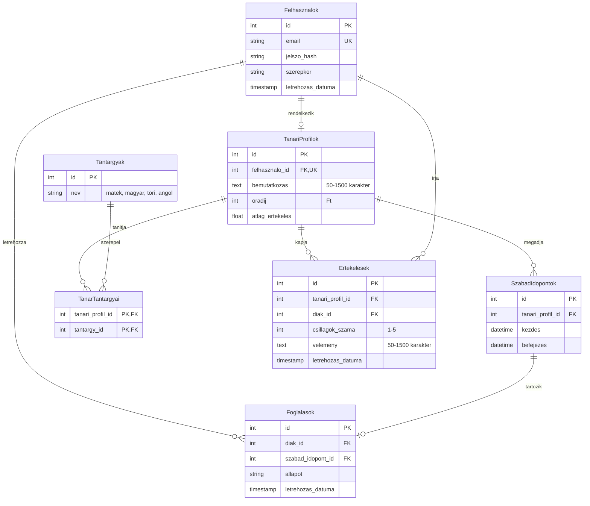

## Entity Relationship Diagram

A diagram a magantanar-kereso.hu.hu által tárolt összes adatot és azok kapcsolatait mutatja be a projekten.

## Kapcsolatok

| Kapcsolat | Típus | Leírás |
|---|---|---|
| Felhasznalok → TanariProfilok | 1 : 1 | Egy felhasználóhoz legfeljebb egy tanári profil tartozhat. Egy tanári profil pontosan egy felhasználóhoz kapcsolódik. |
| TanariProfilok → SzabadIdopontok | 1 : N | Egy tanári profilhoz több szabad időpont tartozhat, egy szabad időpont pedig pontosan egy tanárhoz kapcsolódik. |
| TanariProfilok → TanarTantargyai | 1 : N | Egy tanári profil több tantárgy-hozzárendeléssel rendelkezhet, egy hozzárendelés pedig pontosan egy tanári profilhoz tartozik. |
| Tantargyak → TanarTantargyai | 1 : N | Egy tantárgy több tanárhoz is hozzárendelhető, egy hozzárendelés pedig pontosan egy tantárgyhoz kapcsolódik. |
| Felhasznalok → Foglalasok | 1 : N | Egy diák több foglalást is létrehozhat, egy foglalás pedig egy diákhoz kapcsolódik a `diak_id` mezőn keresztül. |
| SzabadIdopontok → Foglalasok | 1 : 1 | Egy szabad időponthoz legfeljebb egy foglalás tartozhat, egy foglalás pedig egy szabad időponthoz kapcsolódik. |
| TanariProfilok → Ertekelesek | 1 : N | Egy tanár több diáktól is kaphat értékelést, egy diák pedig több különböző tanárt is értékelhet, de ugyanazt a tanárt csak egyszer. |
| Felhasznalok → Ertekelesek | 1 : N | Egy diák több tanárt is értékelhet, de ugyanaz a diák ugyanazt a tanárt csak egyszer értékelheti. |

## Összesítések

A `TanariProfilok` táblában szereplő `atlag_ertekeles` érték az értékelések adataiból kiszámítható:

- **Átlag a csillagos értékelések alapján** = az adott tanárhoz tartozó értékelések `csillagok_szama` mezőinek átlaga.

A foglalások adataiból további összesítések készíthetők:

- **Foglalások száma** = az adott diákhoz vagy tanárhoz tartozó foglalások darabszáma.

Az átlagos értékelést nem szükséges eltárolni, mert az értékelésekből lekérdezéskor is kiszámítható. Ha az `atlag_ertekeles` mezőben tároljátok, új értékelés beküldésekor frissíteni kell.
