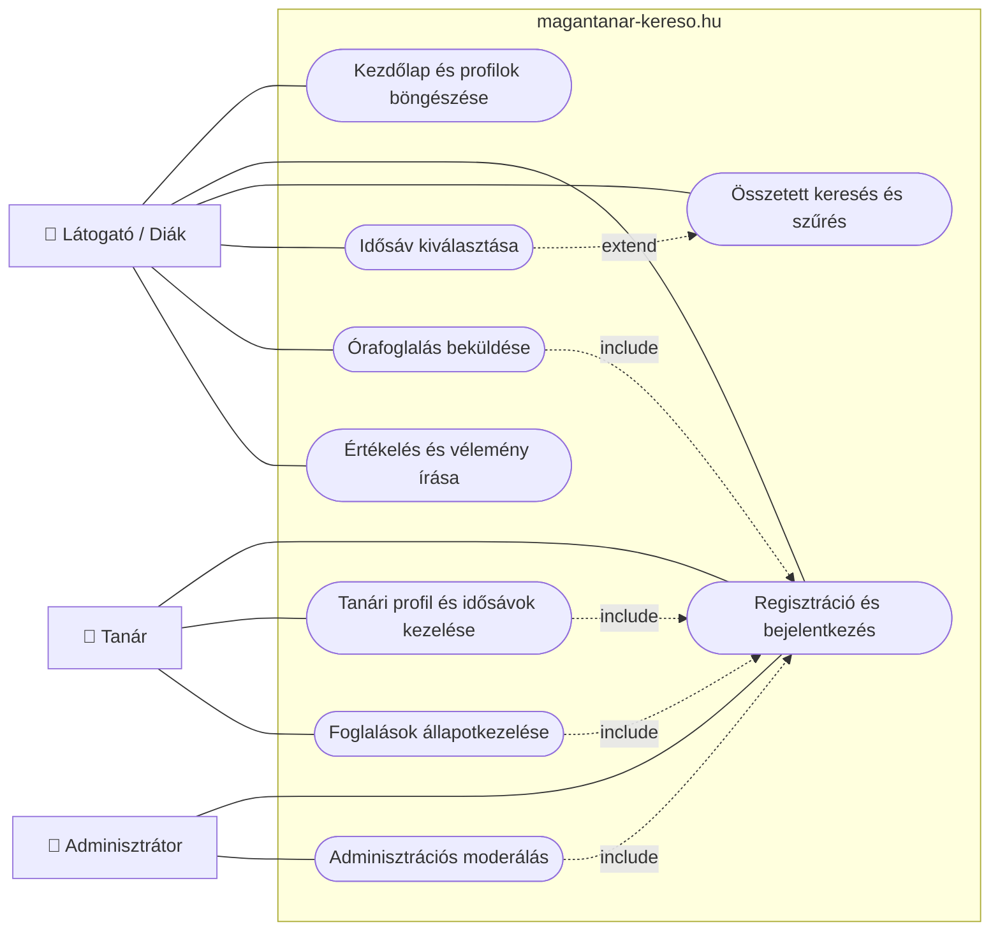

# Use Case diagram

A diagram a magantanar-kereso.hu.hu funkcióit mutatja be a felhasználók szemszögéből, a rendszer belső működése nélkül.

## Használati esetek 

| Felhasználói szerep | Használati eset | Művelet |
|---|---|---|
| Látogató, Diák | Kezdőlap és profilok böngészése | A látogató megnyitja a weboldalt, és megtekinti a kezdőlapot vagy a tanárok profiljait. |
| Látogató, Diák | Regisztráció és bejelentkezés | A látogató a regisztráció vagy bejelentkezés menüpontra kattint, majd megadja a szükséges adatokat. |
| Látogató, Diák | Összetett keresés és szűrés | A látogató megadja a keresési feltételeket, például a tantárgyat és az árkategóriát, majd elindítja a keresést. |
|  Diák | Időpont kiválasztása | A diák megnyitja egy tanár profilját, és kiválaszt egy számára megfelelő szabad időpontot. |
|  Diák | Órafoglalás beküldése | A diák kiválaszt egy szabad időpontot, és elküldi a foglalási kérelmét, ami ekkor "függőben" állapotú. |
|  Diák  | Értékelés és vélemény írása | A diák megnyitja a tanár profilját, a véleményeknél szöveges és csillagos értékelést ad megadott karakterszámban |
| Tanár | Regisztráció és bejelentkezés | A tanár megnyitja a regisztrációs vagy bejelentkezési oldalt, és megadja a szükséges adatokat. |
| Tanár | Tanári profil és idősávok kezelése | A tanár megnyitja a profilszerkesztő felületet, és módosítja a bemutatkozását, az óradíját vagy a szabad időpontjait. |
| Tanár | Foglalások állapotkezelése | A tanár megnyitja a foglalásai listáját, kiválaszt egy foglalást, majd módosítja annak állapotát. |
| Adminisztrátor | Regisztráció és bejelentkezés | Az adminisztrátor megnyitja a bejelentkezési oldalt, és megadja a belépési adatait. |
| Adminisztrátor | Adminisztrációs moderálás | Az adminisztrátor megnyitja az adminisztrációs felületet, és elvégzi a moderálási feladatokat. |

A folytonos vonal azt jelzi, melyik szereplő használja az adott funkciót. Az `include` azt jelenti, hogy az egyik használati eset mindig magában foglalja a másikat. Az `extend` azt jelenti, hogy egy használati eset egy másikat bővít ki, de nem minden esetben kötelező.
